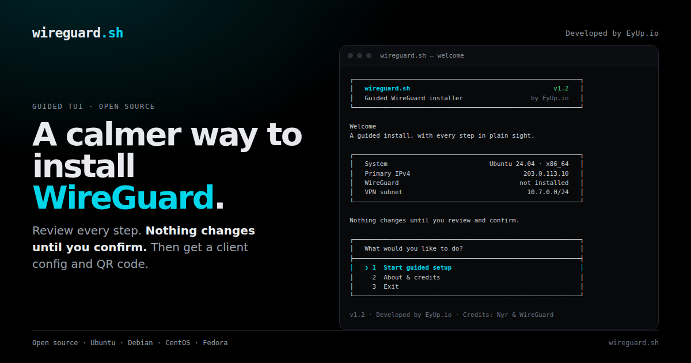

# wireguard.sh

A guided, open-source WireGuard installer for Ubuntu, Debian, CentOS, and Fedora.

[](https://github.com/eyupio/wireguard.sh/actions/workflows/validate.yml)
[](https://github.com/eyupio/wireguard.sh/releases/latest)
[](https://wireguard.sh)



`wireguard.sh` is a small, auditable bash installer with a professional terminal
UI. It detects the server, asks a few clear questions, shows a review screen,
then configures WireGuard and the first client. This repository also contains
the static landing page served at [wireguard.sh](https://wireguard.sh).

## A guided install, not a guessing game

The installer is a reusable TUI built from plain bash and ANSI escape
sequences. It needs no `dialog`, `whiptail`, or extra runtime dependencies.

- Detects the OS, IPv4 and IPv6 addresses, virtualization, and public endpoint.
- Offers arrow-key menus with number-key fallbacks and sensible defaults.
- Shows a complete review screen before changing anything.
- Reports each install step, with package output written to
  `/var/log/wireguardSH.log`.
- Re-run the same command for a dashboard with client add/remove and a guarded
  uninstall flow.
- Prints a client configuration and QR code, and writes the client file with
  `0600` permissions.
- Falls back to plain numbered prompts and ASCII borders when a terminal cannot
  handle the richer TUI.

### TUI options

```text
bash wireguard.sh --help
bash wireguard.sh --version
bash wireguard.sh --preview    # render the TUI screens without changing anything
bash wireguard.sh --dry-run    # walk the wizard and print commands, change nothing
bash wireguard.sh --no-color
bash wireguard.sh --ascii
bash wireguard.sh --verbose
```

## Quick start

> [!IMPORTANT]
> Review the installer before running it. It runs as root and changes network,
> firewall, and service configuration.
> [Read `wireguard.sh` on GitHub](https://github.com/eyupio/wireguard.sh/blob/main/wireguard.sh).

Run one of the following commands as root on a server you control:

```bash
bash <(wget -q -O - https://wireguard.sh/wireguard.sh)
```

or

```bash
bash <(curl -s https://wireguard.sh/wireguard.sh)
```

The TUI opens on the server. It detects the public IPv4 address when possible,
asks for the WireGuard port (default `51820`), the DNS resolver, and the first
client name. On hosts with IPv6, it also configures an IPv6 tunnel address.

## Requirements

- **Operating system:** Ubuntu 18.04+, Debian 10+, CentOS 7+, or Fedora 31+.
- **Privileges:** root access; the installer checks for `EUID 0`.
- **Shell:** `bash`, not `sh`.
- **Service manager:** `systemd`.
- **Network:** a server or VPS with a public IPv4 address (or a hostname that
  resolves to one) and the chosen WireGuard UDP port reachable.
- **Clean host recommended:** the installer is designed for a fresh server. If
  `/etc/wireguard/wg0.conf` already exists, it opens the management dashboard
  instead of reinstalling.

## What the installer does

1. Installs `wireguard`, `qrencode`, and the firewall tooling required by the
   distribution.
2. Writes `/etc/wireguard/wg0.conf` with the server keys, listen port, and VPN
   subnet (`10.7.0.0/24`, plus `fddd:2c4:2c4:2c4::/64` when IPv6 is enabled).
3. Enables IPv4 forwarding and, when configured, IPv6 forwarding through
   `/etc/sysctl.d/30-wireguard-forward.conf`.
4. Configures firewall and NAT rules for the VPN subnet.
5. Enables and starts `wg-quick@wg0`.
6. Creates a client configuration in `~/<client>.conf` and prints its QR code.

The installer uses the host's package manager and downloads the WireGuard tools
it needs.

## Managing an existing installation

Re-run the install command. When `/etc/wireguard/wg0.conf` exists, the TUI shows
the dashboard:

```text
Dashboard
  Status           active
  Interface        wg0
  Endpoint         203.0.113.10:51820/udp
  Clients          3
  IPv6             enabled
  Config           /etc/wireguard/wg0.conf

1) Add a new client
2) Remove an existing client
3) Remove WireGuard
4) About & credits
5) Exit
```

Client configurations are written to `~/<client>.conf`. Scan the printed QR
code with the WireGuard mobile app, or import the file into a desktop client.

## Release sync

The latest GitHub release is shown on the landing page. The page carries a
static fallback and JavaScript refreshes it from the GitHub releases API when
available. If GitHub is unreachable, the fallback
and local links remain usable.

The installer's `APP_VERSION` and the page fallback are kept together by a small
sync tool:

```bash
# Update the static fallback and installer version from the latest release
python3 scripts/sync_release.py

# Check for drift without writing files
python3 scripts/sync_release.py --check

# Use a tag directly, useful in an offline environment
python3 scripts/sync_release.py --from-tag v1.2
```

## Development

The landing page is plain HTML, CSS, and JavaScript with no runtime
dependencies. Static checks and browser tests run in CI on every pull request
and on pushes to `main`.

Requirements: Python 3.9+ and Node.js 20+.

```bash
# Static checks, installer syntax, TUI preview, and installer version
python3 scripts/validate_site.py
npx --yes html-validate@9.7.1 index.html

# Browser smoke tests
npm ci
npx playwright install chromium
npx playwright test
```

The Playwright tests start a local static server automatically. They cover the
copy buttons, no-JavaScript rendering, release sync and fallback, TUI previews,
the 375 px layout, source links, and reduced-motion behavior.

### Project layout

| Path | Purpose |
| --- | --- |
| `index.html`, `index.css`, `index.js` | Static landing page, TUI visuals, release badge |
| `wireguard.sh` | Guided installer served at `/wireguard.sh` |
| `scripts/validate_site.py` | Static content, installer syntax, and TUI preview checks |
| `scripts/sync_release.py` | Syncs version labels with the latest GitHub release |
| `tests/` | Playwright smoke tests |
| `package.json`, `playwright.config.js` | Browser test tooling |
| `.github/workflows/validate.yml` | CI workflow |

## Contributing

Issues and pull requests are welcome. Before opening a pull request, run the
checks in [Development](#development). Keep changes focused and include a short
description of what changed and why.

## Security notes

- Run the installer only on a server you control and trust.
- Read `wireguard.sh` before piping it to `bash`.
- Treat generated client configurations and private keys as secrets.
- Keep the operating system and WireGuard packages up to date.
- Back up `/etc/wireguard/wg0.conf` and client configurations before making changes.

## Credits

This project stands on other people's work, and we are glad to say so.

- **WireGuard** is the creation of Jason A. Donenfeld and the WireGuard
  project. All credit for the protocol, kernel module, tools, and
  documentation belongs to them: <https://www.wireguard.com/>.
- **Nyr's `wireguard-install`** is the installer foundation this project builds
  on. Thank you, Nyr, for the careful work and the generous licence:
  <https://github.com/Nyr/wireguard-install>.
- **EyUp.io** develops and maintains the guided TUI and this landing page:
  <https://eyup.io>.

`wireguard.sh` is independent and is not affiliated with, endorsed by, or
supported by the WireGuard project or Nyr. Any mistakes here are ours.

## License

This repository includes two license files:

- [LICENSE](LICENSE) — GNU General Public License v3.0.
- [LICENSE.md](LICENSE.md) — MIT License.

Review both files for the terms that apply to the installer and the landing page.

## Links

- Website: <https://wireguard.sh>
- Latest release: <https://github.com/eyupio/wireguard.sh/releases/latest>
- WireGuard documentation: <https://www.wireguard.com/>
- WireGuard clients: <https://www.wireguard.com/install/>
- Source and issues: <https://github.com/eyupio/wireguard.sh>
- EyUp.io: <https://eyup.io>
